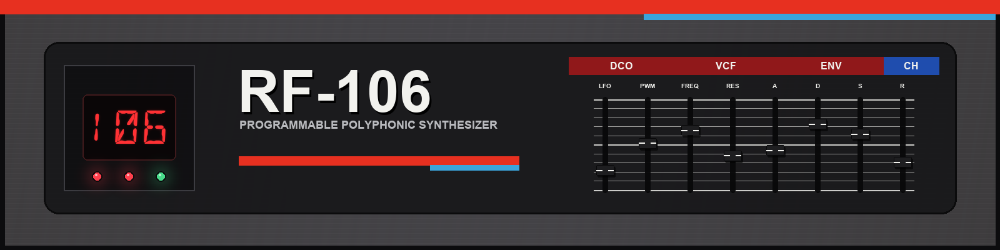

# RF-106

RF-106 is a six-voice subtractive synth for RackForge inspired by the Roland JUNO-106. Its pulse, saw, sub oscillator and noise give you the raw sound, a resonant low-pass filter shapes it, and a stereo chorus can spread it across the speakers.

## Install

RF-106 is included in the RackForge Standard bundle. To install it separately, download `RF-106.rfplugin` and choose **Install plugin** in RackForge's **Plugin Manager**. [Download RF-106](https://github.com/kalexis1994/rackforge-plugin-rf-106/releases/latest)

## Play and shape a sound

Open **RF-106** in PLAY and use the program selector to browse the 128 factory sounds. **A11 Brass** is a starting point for learning the panel. Play a held chord and sweep the **VCF** frequency to hear how much of the oscillator's brightness passes through.

| Section | What to try |
| --- | --- |
| **DCO** | Switch on **Pulse** or **Saw**. Raise **Sub** to add an octave below and use **Noise** for breath or texture. In LFO mode, **PWM** adds movement to the pulse wave. |
| **HPF** and **VCF** | Use the high-pass filter to thin the low end. Lower the VCF frequency for a darker sound and raise resonance to emphasize the cutoff. |
| **ENV** and **VCA** | Set the shape with attack, decay, sustain and release. Switch between the envelope and gate modes to hear the difference when you let go of the keys. |
| **Chorus** | Compare off, **I** and **II** on a sustained chord. |

## Bring your own programs

Open **CONFIG** and use **LOAD** in a cassette bay to install a Juno-106 Librarian `.106` bank or compatible JUNO-106 `.syx` tone dump. Each populated bay appears as a bank in the program selector. Save an edited sound as a copy in **Your programs** to keep it alongside the factory and imported banks. [Program transfer guide](docs/PROGRAM_TRANSFER.md)

## License

RF-106 is distributed under GPL-3.0-only. [License](LICENSE) · [Notices](NOTICE.md)
